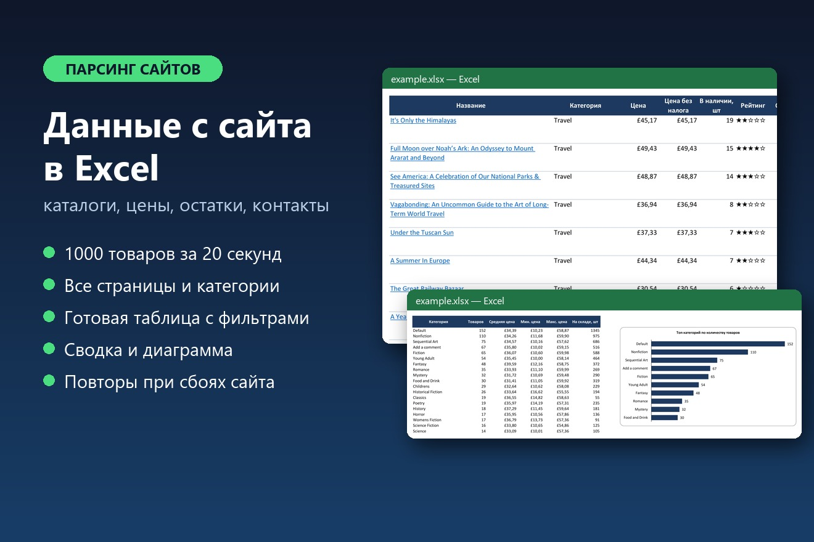
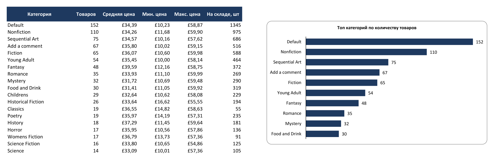

# Парсер каталога интернет-магазина → Excel

[](https://github.com/lihor0/site-parser/actions/workflows/tests.yml)



Собирает все товары каталога (все категории и страницы) и выгружает в готовую к работе Excel-таблицу:
со ссылками, фильтрами, сводкой по категориям и диаграммой.

**Результат:** 1000 товаров из 50 категорий за ~20 секунд. Пример выгрузки — [`docs/example.xlsx`](docs/example.xlsx).

> Демо работает на [books.toscrape.com](https://books.toscrape.com) — учебном магазине, созданном специально
> для тренировки парсинга. Архитектура переносится на любой сайт: меняется только модуль разбора страниц.

**Стек:** Python 3.11+, httpx (async), BeautifulSoup, openpyxl, pytest

## Что в Excel

| Лист | Содержимое |
|---|---|
| **Товары** | Название (ссылка на товар), категория, цена, цена без налога, остаток, рейтинг ★, отзывы, артикул, описание, ссылка на фото. Закреплённая шапка, автофильтр, денежный формат |
| **Сводка** | По каждой категории: число товаров, средняя/мин/макс цена, остаток на складе, строка «ИТОГО» с формулами, диаграмма топ-10 |
| **Инфо** | Источник, дата выгрузки, сколько собрано, сколько не удалось, время работы |



## Возможности

- **Обход всего каталога**: категории из меню → все страницы пагинации → карточка каждого товара
- **Быстро**: асинхронные запросы, параллельность настраивается (`--concurrency`)
- **Бережно к сайту**: ограничение одновременных запросов, пауза между запросами (`--delay`)
- **Надёжно**: повтор при ошибках сервера и обрывах сети с нарастающей паузой; один сломанный товар не останавливает выгрузку
- **Фильтры**: только нужные категории, лимит товаров на категорию
- **CSV** дополнительно к Excel — открывается в Excel без «кракозябр»
- **13 автотестов**: разбор страниц на сохранённом HTML, весь цикл парсинга на эмуляции сайта (включая сбои), проверка готового Excel

## Запуск

```bash
python -m venv .venv
# Windows: .venv\Scripts\activate    Linux/macOS: source .venv/bin/activate
pip install -r requirements.txt

python -m catalog_parser                                  # весь каталог → products.xlsx
python -m catalog_parser -c "Travel,Mystery" -o books.xlsx  # только выбранные категории
python -m catalog_parser -l 10 --csv                      # по 10 товаров из категории + CSV
python -m catalog_parser --concurrency 3 --delay 0.5      # аккуратный режим
```

```
  товаров: 1000/1000
Готово: 1000 товаров за 21.1 с → products.xlsx
```

## Тесты

```bash
pip install -r requirements-dev.txt
pytest
```

## Структура

```
catalog_parser/
├── __main__.py   # командная строка
├── fetcher.py    # HTTP: параллельность, паузы, повторы
├── pages.py      # разбор HTML (чистые функции, без сети)
├── scraper.py    # обход каталога
├── export.py     # Excel и CSV
└── models.py     # модель товара
tests/
├── fixtures/     # сохранённые страницы сайта
├── test_pages.py
├── test_scraper.py
└── test_export.py
```

## Под заказ

Парсинг любого сайта или маркетплейса · выгрузка в Google Таблицы · запуск по расписанию ·
отслеживание изменения цен с уведомлением в Telegram · обход защиты через браузер (Playwright)
